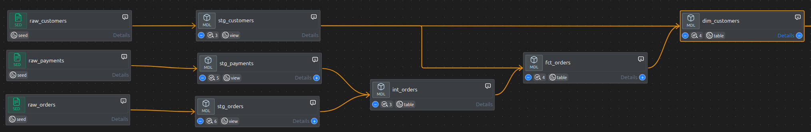
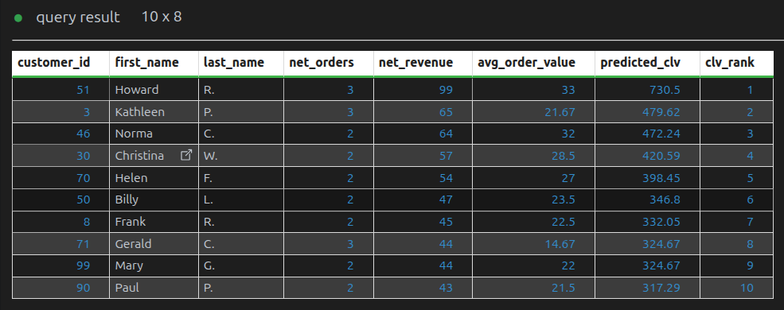
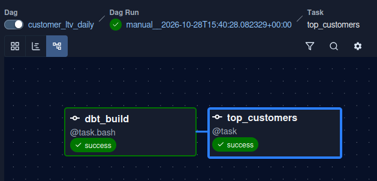
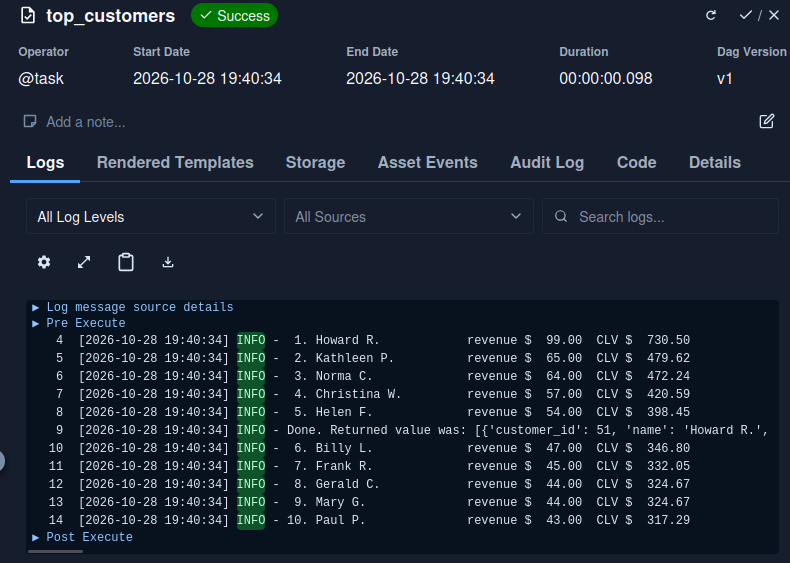
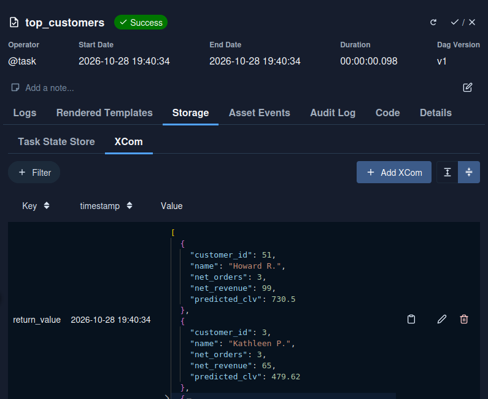

# Customer LTV Pipeline
 
Batch ELT pipeline that turns raw e-commerce exports (customers, orders,
payments) into a tested customer lifetime value table. dbt models the data in
DuckDB, and Airflow runs the build every day and reports the top customers.
 
 
## Stack
 
| Layer | Tool |
|---|---|
| Storage and compute | DuckDB 2.0 (local file) |
| Transformations and tests | dbt-core 1.12, dbt-duckdb 1.11 |
| Orchestration | Apache Airflow 3.3.2 |
| Environment | uv, Python 3.12, Ubuntu 24.04 |
| Editor | VS Code with Power User for dbt |
 
## Data
 
Three CSV exports, loaded as dbt seeds:
 
| Seed | Rows | Details |
|---|--:|---|
| `raw_customers` | 100 | one row per customer |
| `raw_orders` | 99 | one row per order; status is `placed`, `shipped`, `completed`, `return_pending` or `returned` |
| `raw_payments` | 113 | one row per payment; amount in cents; an order can have more than one payment |
 
The data is the sample shop dataset from
[dbt-labs/jaffle_shop](https://github.com/dbt-labs/jaffle_shop) (Apache 2.0).
 
## Models




 Layer | Model | Materialized as | Purpose |
|---|---|---|---|
| staging | `stg_customers`, `stg_orders`, `stg_payments` | view | Rename columns, convert payments from cents to dollars |
| intermediate | `int_orders` | table | One row per order with the total paid (13 orders have more than one payment) |
| marts | `fct_orders` | table | One row per order, with customer name and an `is_returned` flag |
| marts | `dim_customers` | table | One row per customer: order dates, order counts, net revenue, predicted CLV |
 
## Customer lifetime value

`dim_customers.predicted_clv` uses the classic formula:
 
```
CLV = average order value × orders per month × expected lifespan (months)
```
Calculations and terms:-
- **Net orders:** all orders except returned or return_pending ones.
- **Net revenue:** total paid amount on net orders.
- **Average order value:** net revenue / net orders.
- **Orders per month:** net orders / months covered by the data
  (1 Jan to 9 Apr 2018, about 3.25 months).
- **Lifespan:** 24 months. This is an assumption (dbt var `clv_lifespan_months`).

For the average customer (`analyses/clv_summary.sql`): 60 buying customers,
average order value $17.04, 0.476 orders per month, 24 months, CLV $194.91.
 
With one shared window, the formula reduces to monthly net revenue × lifespan,
so the ranking follows net revenue. Using each customer's own tenure instead
pushes one-order customers from late March to the top, which is noise at this
data size.

## Data quality
 
`dbt build` runs 32 nodes: 3 seeds, 6 models and 23 tests.
 
- `unique` and `not_null` on every primary key
- `relationships`: orders to customers, payments to orders, `fct_orders` to `dim_customers`
- `accepted_values` on order status and payment method
- `assert_payments_reconcile` (singular test): the total in `fct_orders` must
  equal the total in `stg_payments`. It catches a join that fans out or drops rows.
Airflow runs `dbt build`, so a failed test fails the `dbt_build` task and the
report task does not run.

## Result
Top 10 customers by predicted CLV (24-month lifespan):



## Orchestration
 
DAG `customer_ltv_daily`: schedule `@daily`, `catchup=False`,
`max_active_runs=1`, 1 retry.
 
1. `dbt_build`: `BashOperator` running `dbt build --target prod`
2. `top_customers`: `@task` that reads `dim_customers` from `data/prod.duckdb`
   (read-only), logs the top 10 by predicted CLV and returns them as an XCom



**Figure1:  Airflow DAG graph**


**Figure2: Top customers task log**


**Figure3: XCOM from top customer query**

## Settings in VS Code
 
`.vscode/settings.json` points the Python extension at `.venv`, associates
`*.sql` and `*.yml` with `jinja-sql` and `jinja-yaml` for Power User, and sets
the environment variables for both the terminal and the extension

## Design notes
 
- **Two DuckDB files.** DuckDB allows one writer per file. The editor works on
  `data/dev.duckdb` (target `dev`) and the DAG on `data/prod.duckdb` (target
  `prod`), so an open query in VS Code never blocks a scheduled run.
- **`keep_open: false` on dev.** dbt-duckdb keeps its connection open by
  default, and Power User keeps dbt loaded in a background Python process.
  With the default, the extension still holds the lock on `dev.duckdb` after a
  query preview, and `dbt build` in the terminal fails with
  `Could not set lock on file`. With `keep_open: false` the file is released
  after each query.
- **Staging selects from seeds with `ref()`, not `source()`.** With `source()`,
  dbt does not know the staging views depend on the seeds, and a single
  `dbt build` on an empty database creates the views before the seed tables
  exist.
