# PostgreSQL 18 pipeline lab: CDC and partitioning

Change data capture and table partitioning on PostgreSQL 18, built and tested with native features only.

**Goal:** build CDC on PostgreSQL 18 without an external CDC tool (no Debezium, Fivetran or Kafka), see how it breaks, and keep a 5M-row events table fast to query and easy to maintain.

## Why this project?

I wanted to understand CDC before I put a tool like Debezium in front of it. What does Postgres do when a row changes? Where does the change go, who keeps track of it, and what breaks when the consumer falls behind?

Postgres is where I like to try things out, so I built the smallest CDC pipeline I could on a local PostgreSQL 18: a replication slot, the wal2json plugin, `pg_recvlogical` and plain SQL. Then I broke it on purpose to see how it fails.

## What the lab does

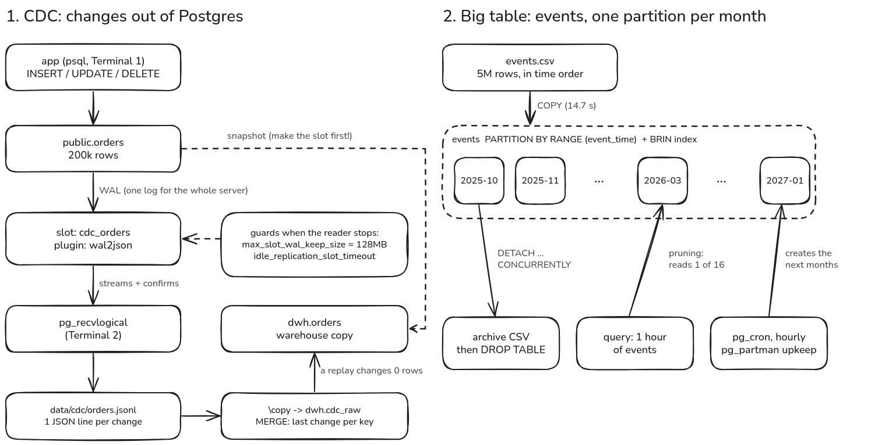

Left: the app writes to `orders`, a replication slot keeps every change, `pg_recvlogical` writes the changes to a JSON file, and one `MERGE` applies the file to a warehouse copy. Right: 5M events bulk-loaded into monthly partitions, kept ahead by an hourly job, with the oldest month detached and archived.

## Stack

PostgreSQL 18.7 on Ubuntu 24.04, in its own local cluster. Generated data: 50k customers, 200k orders, 5M events.

| Tool | What it does here |
| --- | --- |
| [wal2json](https://github.com/eulerto/wal2json) | Output plugin for logical decoding. Turns the WAL changes on `orders` into JSON. |
| [pg_recvlogical](https://www.postgresql.org/docs/18/app-pgrecvlogical.html) | Ships with Postgres. Streams the changes from the slot into a file: my CDC reader. |
| [pg_partman](https://github.com/pgpartman/pg_partman) | Creates the monthly partitions of `events`, 2 months ahead. |
| [pg_cron](https://github.com/citusdata/pg_cron) | Cron inside the database. Runs the pg_partman upkeep every hour. |

Six settings differ from a default cluster ([conf/lab.conf](conf/lab.conf)). The key one is `wal_level = logical`. `max_slot_wal_keep_size = 128MB` is small on purpose, so I could watch a slot hit it.

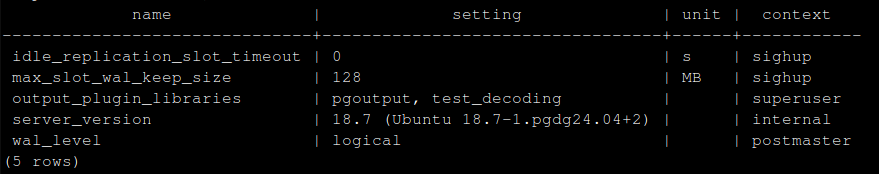

## What it looks like

### CDC

**1. Plugin allow-list.** Since PostgreSQL 18.6, a slot can load only the plugins listed in `output_plugin_libraries`. My first slot creation was refused until wal2json was on the list.

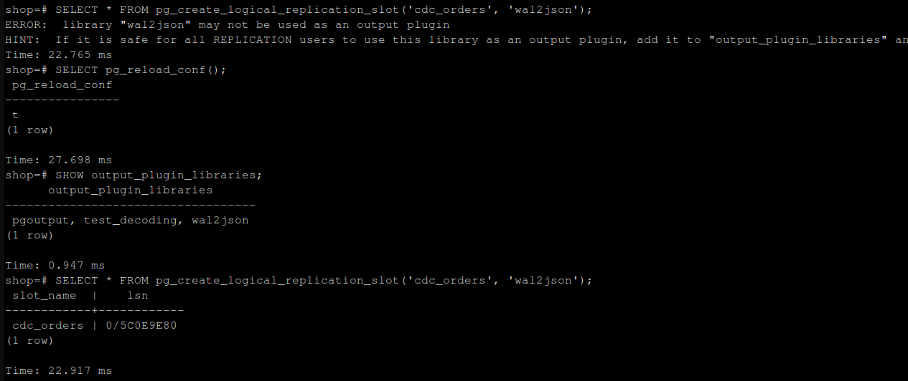

**2. The reader.** `pg_recvlogical` streams the slot into a file: 1,600 JSON lines for 1,000 inserts, 500 updates and 100 deletes.

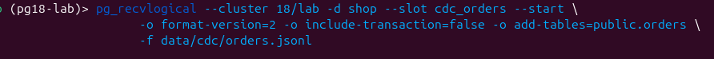

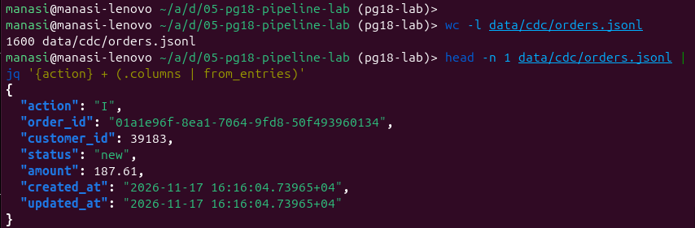

**3. Safe replay.** Left: the first apply. Right: the same file applied again changes 0 rows. Source and target have the same checksum.

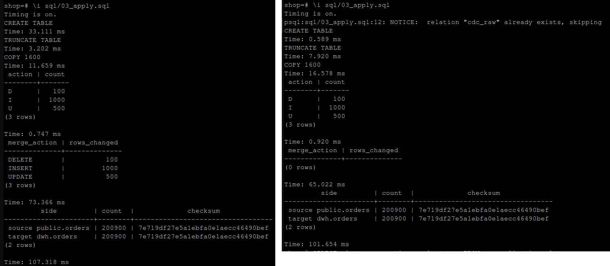

**4. Reader down, slot lost.** A 2M-row write to another table took the slot from `reserved` to `unreserved` (-174 MB of room), and the next checkpoint made it `lost`.

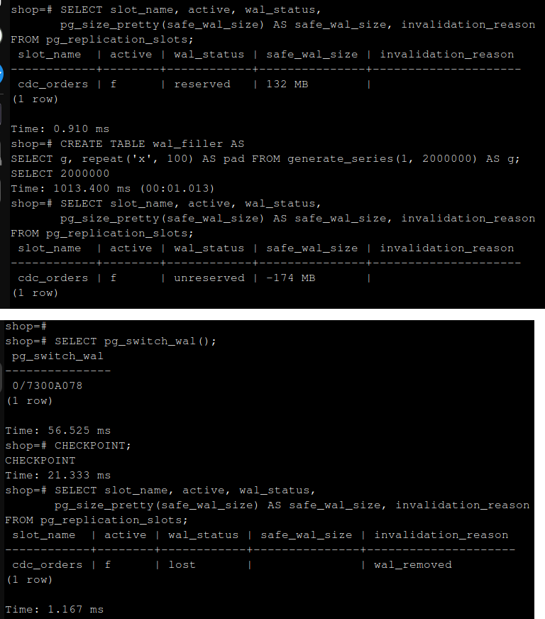

**5. Idle slot.** PG 18's `idle_replication_slot_timeout` (30 s here) invalidates a slot that nobody reads.

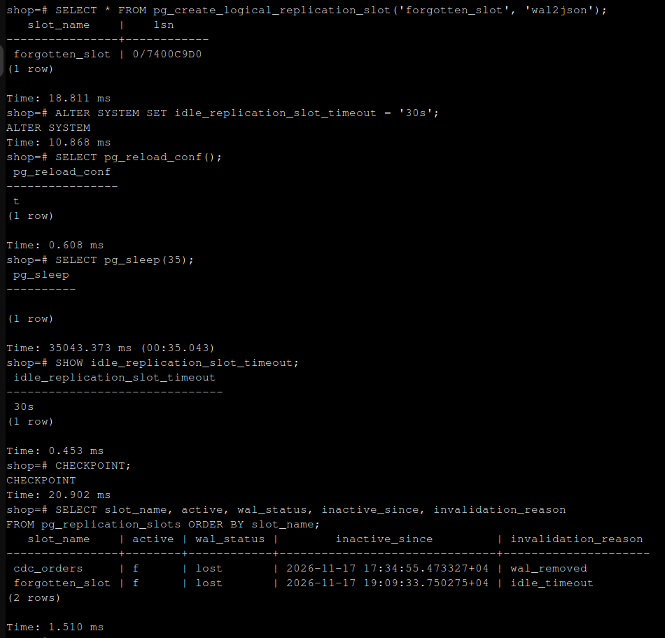

### Partitioned table

**6. Pruning.** With pruning on, a 1-hour query reads one partition. With it off, every partition is in the plan.

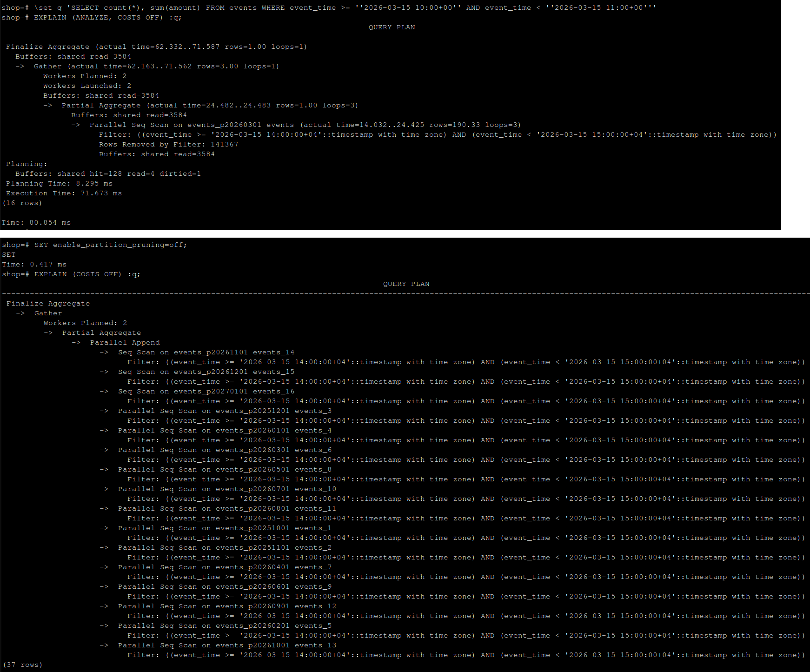

**7. BRIN vs B-tree.** The same column, indexed 2 ways: BRIN 384 kB, B-tree 107 MB.

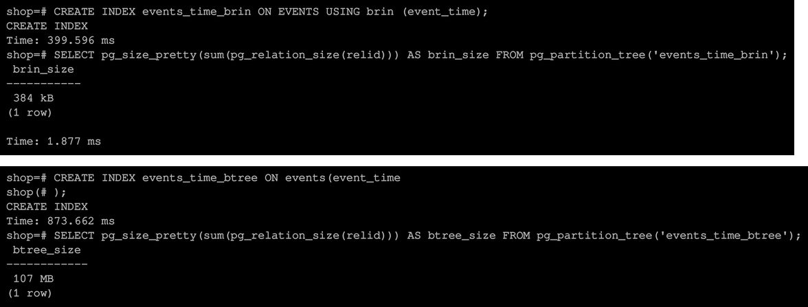

**8. A plan per partition.** In my +04 session, a UTC month spans 2 partitions. The planner seq-scans the one where almost every row matches, and uses the index on the other.

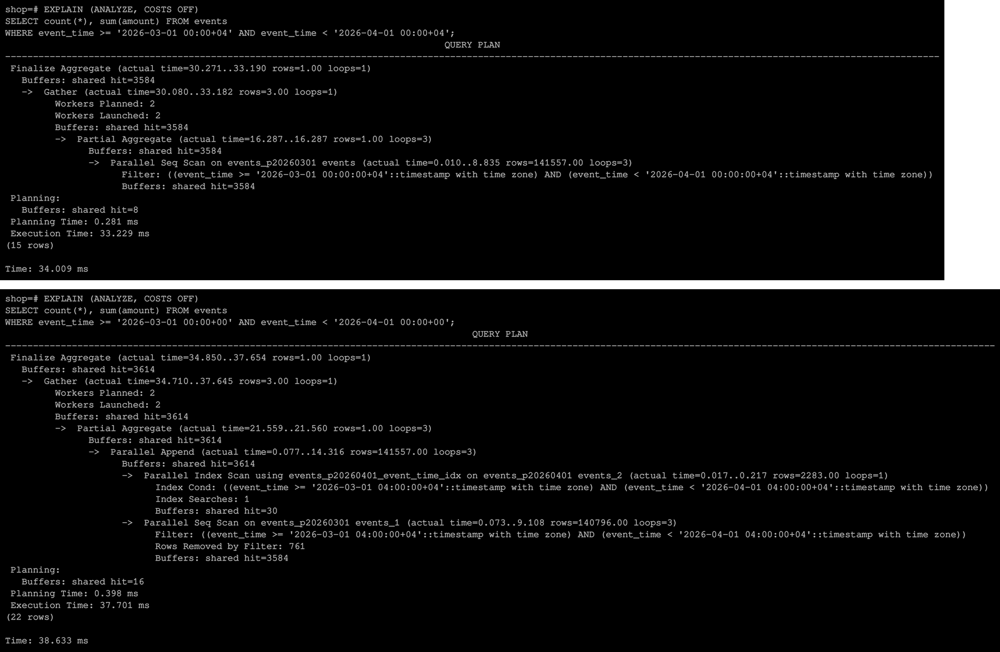

**9. Upkeep.** pg_cron runs the pg_partman job. The oldest month is detached in 33.6 ms without blocking the table, archived and dropped.

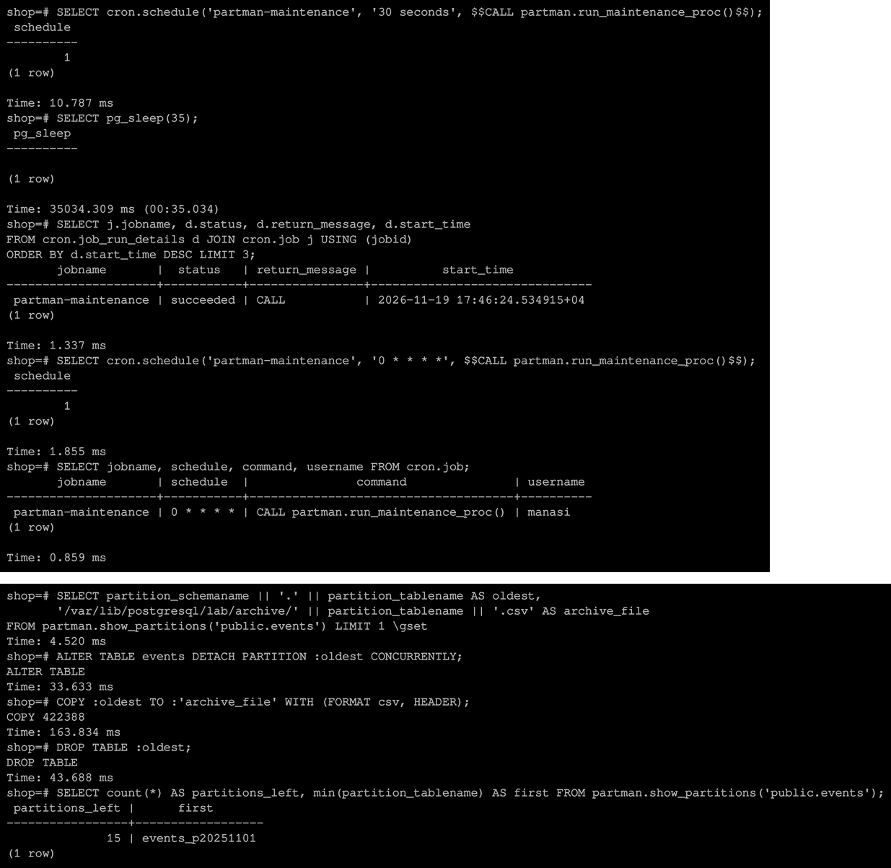

## Results

| Measure | Result |
| --- | --- |
| `COPY` of 5M rows into the partitioned table | 14.7 s |
| Changes captured / reader lag after catch-up | 1,600 / 0 bytes |
| Same change file applied twice | 0 rows changed the second time, same checksum |
| `safe_wal_size` after a 2M-row write to another table | 132 MB -> -174 MB, then `lost` |
| 1-hour query with partition pruning | 1 of 16 partitions read |
| BRIN vs B-tree size | 384 kB vs 107 MB |
| Detach and archive of the oldest month | 33.6 ms, 422,388 rows |

On my laptop: 20 CPUs, 16 GB RAM.

## What I learned

- **A slot holds WAL for the whole server, not for one table.** A write to an unrelated table pushed my `orders` slot past its limit. PG 18 adds a second guard for idle slots. A lost slot means a new slot and a new snapshot.
- **Slot first, then snapshot.** A change can then arrive twice, but never zero times. So the apply keeps the last change per key and updates a row only when a value differs.
- **`PARTITION BY` creates no partitions.** pg_partman creates them from dates, not from the data, and my +04 session put the month bounds at 20:00 UTC.
- **The planner decides per partition:** a seq scan where most rows match, the index where few do.
- **BRIN suits append-only time data.** It is tiny and nearly free on insert. A B-tree is faster for narrow lookups, but here it was about 280 times larger.
- **Compare warm runs.** My first `EXPLAIN (ANALYZE)` read every page from the OS.
- **Small things that cost me time:** `\i` is a psql command, not a bash one. wal2json options use hyphens (`format-version`). Server-side `COPY` needs a folder that the `postgres` user can write to.

## How this maps to production

Every Postgres CDC tool reads through a slot. Fivetran, Airbyte and Google Datastream require `pgoutput`, Debezium usually uses it, and AWS DMS uses `pglogical` or `test_decoding`. Whatever the tool, the Postgres side is the same: slots, WAL retention, a first snapshot and an idempotent apply. For partition upkeep, AWS documents the same pg_partman + pg_cron pair on RDS.

## Repository

```text
conf/lab.conf     server settings for the lab cluster
sql/              load, CDC, apply, slot failures, partitioned-table queries (run step by step in psql)
docs/img/         diagram and terminal screenshots
pg_settings.png   the settings, as the server reports them
```

## References

- [PostgreSQL 18: Logical decoding concepts](https://www.postgresql.org/docs/18/logicaldecoding-explanation.html)
- [PostgreSQL 18: pg_replication_slots](https://www.postgresql.org/docs/18/view-pg-replication-slots.html)
- [PostgreSQL 18: Replication settings](https://www.postgresql.org/docs/18/runtime-config-replication.html)
- [PostgreSQL 18.6 release notes (output_plugin_libraries)](https://www.postgresql.org/docs/release/18.6/)
- [PostgreSQL 18: MERGE](https://www.postgresql.org/docs/18/sql-merge.html)
- [PostgreSQL 18: Table partitioning](https://www.postgresql.org/docs/18/ddl-partitioning.html)
- [PostgreSQL 18: BRIN indexes](https://www.postgresql.org/docs/18/brin.html)
- [Debezium PostgreSQL connector](https://debezium.io/documentation/reference/stable/connectors/postgresql.html)
- [Amazon RDS: partitions with pg_partman and pg_cron](https://docs.aws.amazon.com/AmazonRDS/latest/UserGuide/PostgreSQL_Partitions.html)
