# PostgreSQL 18 pipeline lab: CDC and partitioning
 
A practice project: change data capture (CDC) built with only Postgres and three extensions, plus the partitioning work that a growing events table needs.
 
**Goal:** build and test CDC on PostgreSQL 18 without an external CDC tool (no Debezium, Fivetran or Kafka), and keep a 5M-row events table fast to query and easy to maintain. The project covers 4 areas:
 
- **CDC from first principles:** a logical replication slot, the wal2json output plugin and `pg_recvlogical`. The start has no gap (slot first, then snapshot), and the apply is an idempotent `MERGE`: a replay changes nothing.
- **CDC operations:** what happens when the consumer stops. This covers WAL retention, slot invalidation, and the two guards: `max_slot_wal_keep_size`, and in PG 18, `idle_replication_slot_timeout`.
- **Read performance:** partition pruning, and BRIN vs B-tree indexes, measured with `EXPLAIN (ANALYZE)`.
- **Partition lifecycle:** future partitions created on a schedule (pg_partman + pg_cron), and the oldest month retired without blocking writes (`DETACH PARTITION ... CONCURRENTLY`).

 
## Why this project?
 
I wanted to understand CDC before I put a tool like Debezium in front of it. What does Postgres do when a row changes? Where does the change go, who keeps track of it, and what breaks when the consumer falls behind?
 
Postgres is where I like to try things out, so I built the smallest CDC pipeline I could on a local PostgreSQL 18: a replication slot, the wal2json plugin, `pg_recvlogical` and plain SQL. Then I broke it on purpose to see how it fails.
 
## How CDC works in Postgres
 
| Part | Job |
| --- | --- |
| WAL (write-ahead log) | Postgres writes every change here first. |
| Logical decoding | Turns WAL records back into row changes. |
| Replication slot | Remembers how far the reader has got, and keeps the WAL the reader still needs. |
| Output plugin | Sets the format of the changes. `pgoutput` is the built-in binary protocol. `wal2json` gives JSON. |
 
Compared with a batch query on `updated_at`, CDC also catches deletes, keeps the order of changes, and does not scan tables again and again.
 
## What the lab does

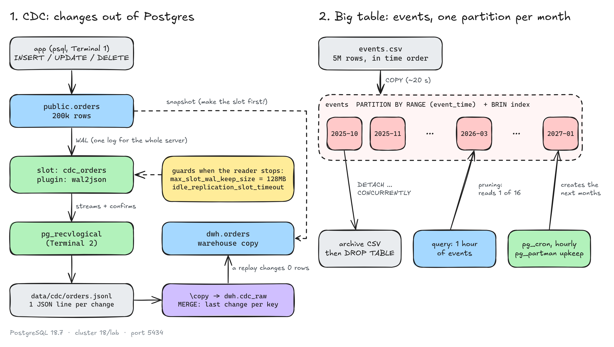  
The left side is the CDC path. The app writes to orders, a slot keeps the changes, pg_recvlogical writes them to a file, and one MERGE applies the file to a warehouse copy.  

The right side is the events table: a bulk load into monthly partitions, queries that read only the partition they need, an hourly job that creates the next months, and the oldest month detached and archived without blocking writes.
 
## Stack
 
PostgreSQL 18.7 on Ubuntu 24.04, in a separate local cluster (port 5434).
 
| Extension / tool | What it is for in general | What I use it for here |
| --- | --- | --- |
| [wal2json](https://github.com/eulerto/wal2json) | An output plugin for logical decoding. It turns the changes in the WAL into JSON. A replication slot loads it, so there is no `CREATE EXTENSION`. | To read every insert, update and delete on `orders` as one JSON line. |
| [pg_partman](https://github.com/pgpartman/pg_partman) | Creates and manages time-based and number-based partition sets. It makes future partitions ahead of time and can drop old ones. | Monthly partitions for `events`, created 2 months ahead. |
| [pg_cron](https://github.com/citusdata/pg_cron) | A cron-style job scheduler that runs inside the database. A job is a SQL command on a schedule. | Runs the pg_partman upkeep every hour. |
| [pg_recvlogical](https://www.postgresql.org/docs/18/app-pgrecvlogical.html) | A client tool that ships with Postgres. It streams changes from a logical replication slot. | The CDC reader: it writes the JSON changes to a file. |
 
## Data
 
A small online shop, generated with `generate_series`, so every run gives the same data.
 
| Table | Rows | Role |
| --- | --- | --- |
| `customers` | 50,000 | Lookup table |
| `orders` | 200,000 | The app's table. CDC reads its changes. |
| `events` | 5,000,000 | Big, time-ordered table, partitioned by month |
 
## Settings
 
Only five settings differ from a default cluster ([conf/lab.conf](conf/lab.conf)). The one that matters most is `wal_level = logical`: without it, the WAL does not hold enough detail for CDC.
 
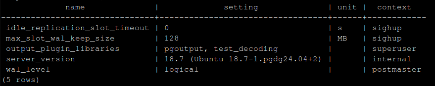
 
## How this maps to real CDC stacks
 
| In this lab | In production |
| --- | --- |
| Replication slot + output plugin | Every Postgres CDC tool reads through a slot. Debezium, Fivetran, Airbyte and Google Datastream use `pgoutput` with a publication. AWS DMS uses `pglogical` or `test_decoding`. |
| wal2json | I use it because its output is easy to read. The lab also looks at raw `pgoutput` messages, which is what the tools receive. |
| Slot guards (`max_slot_wal_keep_size`, PG 18 `idle_replication_slot_timeout`) | They protect the source database's disk when a consumer stops. |
| Slot first, then snapshot, then idempotent `MERGE` | The same start-up order that CDC tools use: first a snapshot, then the stream. Spark does the apply with `MERGE INTO` on Delta and Iceberg tables. |
| pg_partman + pg_cron | AWS documents this pair for partition upkeep on RDS and Aurora. |
| Detach and drop a partition | The standard way to remove old logs and events. Much faster than a bulk `DELETE`. |
| BRIN index | For very large tables where a column follows the row order on disk, such as event time. |
 
The common stacks are Debezium on Kafka Connect (open source), AWS DMS or Google Datastream (cloud-managed), and Fivetran or Airbyte (SaaS). The Postgres side is the same for all of them: slots, WAL retention, the first snapshot and an idempotent apply. This lab covers that side.
 
## What it looks like

Screenshots from my terminals: Terminal 1 runs `psql`, Terminal 2 runs `pg_recvlogical` and shell commands.

### CDC from first principles

**1. The output plugin must be allowed.** Since PostgreSQL 18.6, a slot can load only the plugins listed in `output_plugin_libraries`. The first slot creation is refused. After a reload with wal2json on the list, the same call returns the slot name and its start position (LSN).

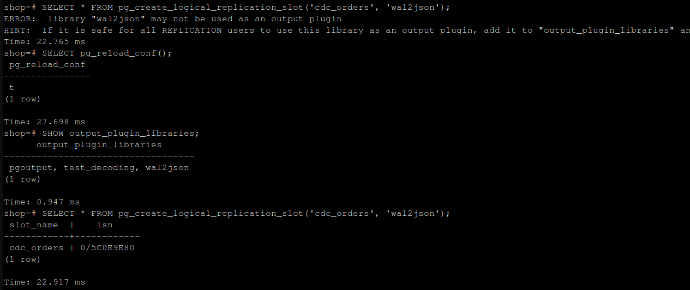

**2. The reader streams the changes to a file.** `pg_recvlogical` reads the slot and writes one JSON line per row change: 1,600 lines for 1,000 inserts, 500 updates and 100 deletes.

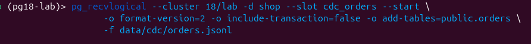

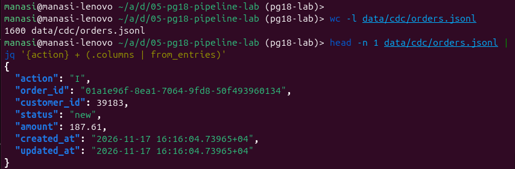

**3. Applying the file twice gives the same result.** Left: the first run of the apply script. The `MERGE` inserts, updates and deletes rows. Right: the second run of the same file. The `MERGE` changes 0 rows. In both runs, source and target have the same row count and the same checksum.

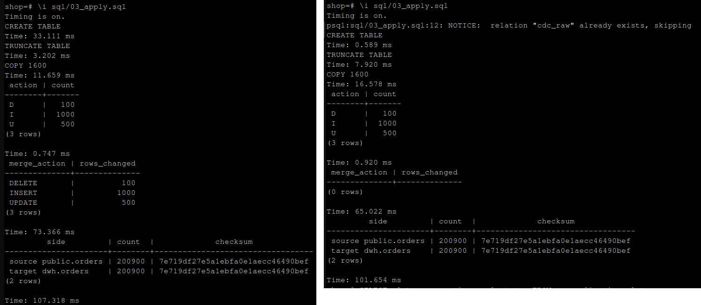

### CDC operations

**4. A stopped reader, a full slot.** With no reader, a 2M-row write to another table pushes the slot over its 128 MB limit: `reserved`, then `unreserved` with `safe_wal_size` at -174 MB. After `pg_switch_wal()` and a checkpoint, the slot is `lost`.

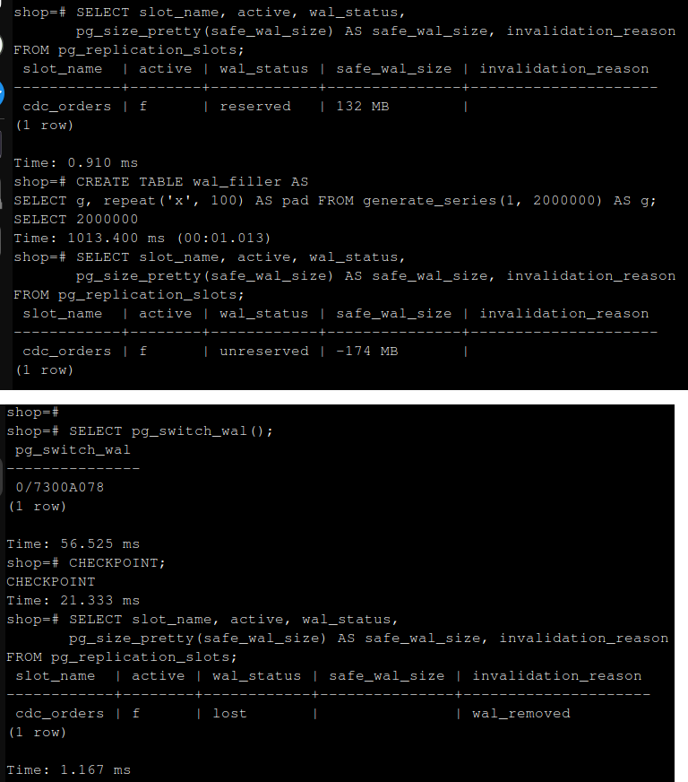

**5. A slot that nobody uses.** With PG 18's `idle_replication_slot_timeout` at 30 s, an unused slot is invalidated at the next checkpoint, with reason `idle_timeout`.

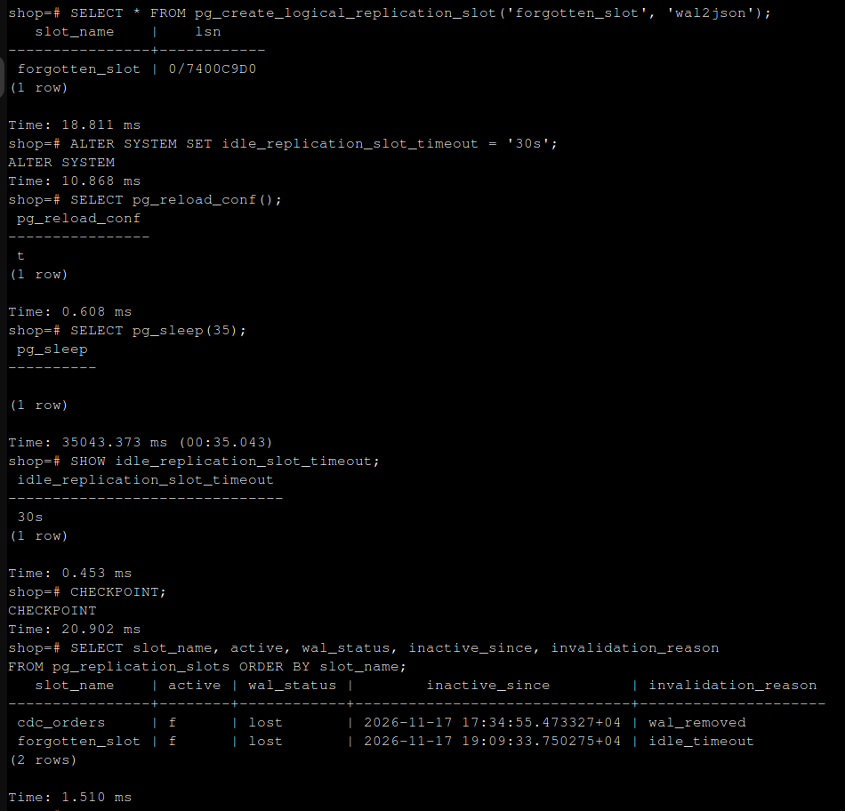

### Read performance

**6. Partition pruning.** Top: with pruning on, the plan for a 1-hour query reads only the March partition. Bottom: with pruning off, the same plan lists every partition.

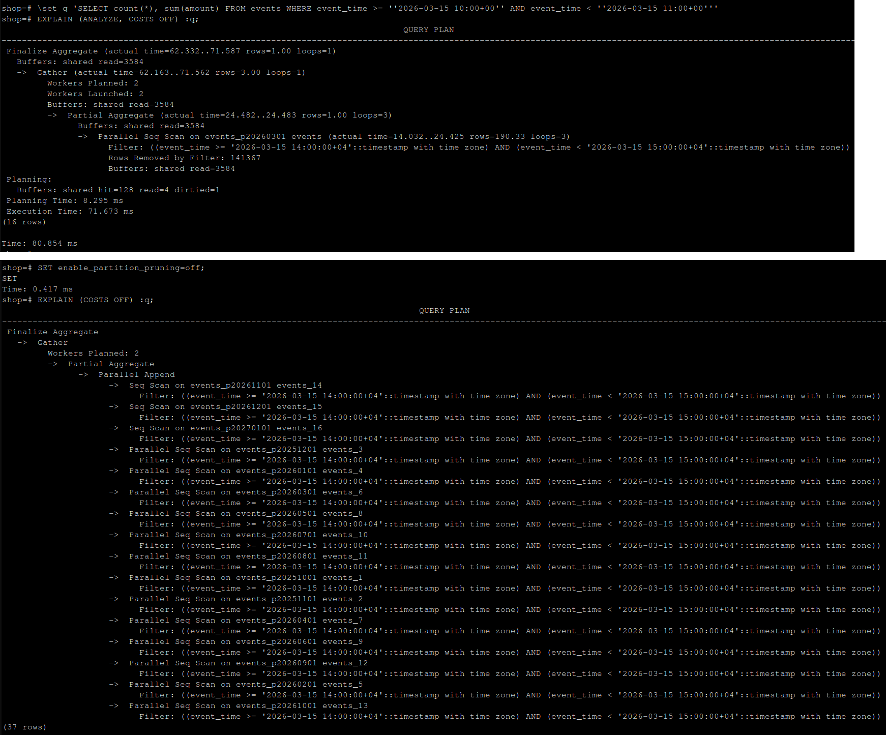

**7. BRIN vs B-tree.** The same column, indexed 2 ways. BRIN keeps only a min and max per range of pages: 384 kB, built in 0.40 s. The B-tree keeps one entry per row: 107 MB, built in 0.87 s.

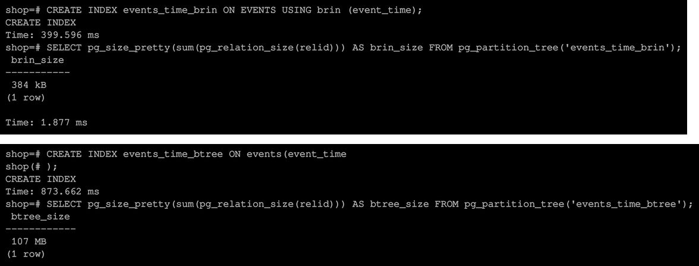

**8. The planner chooses per partition.** Top: March in my own +04 zone matches 1 partition, and the planner reads all of it with a seq scan. Bottom: March in UTC covers 2 of my partitions. The planner reads March with a seq scan (almost every row matches), and the first 4 hours of April with the index.

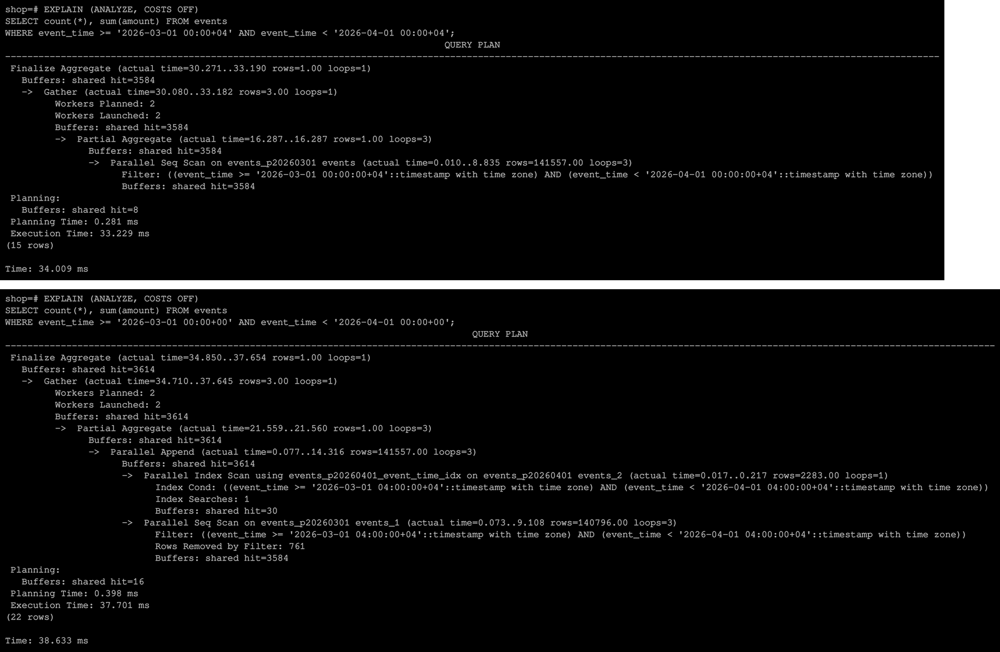

### Partition lifecycle

**9. Upkeep without downtime.** Top: the pg_cron job that runs the pg_partman upkeep succeeded, and then moves to an hourly schedule. Bottom: the oldest month is detached in 33.6 ms while the table stays open, copied to an archive file (422,388 rows), and dropped.

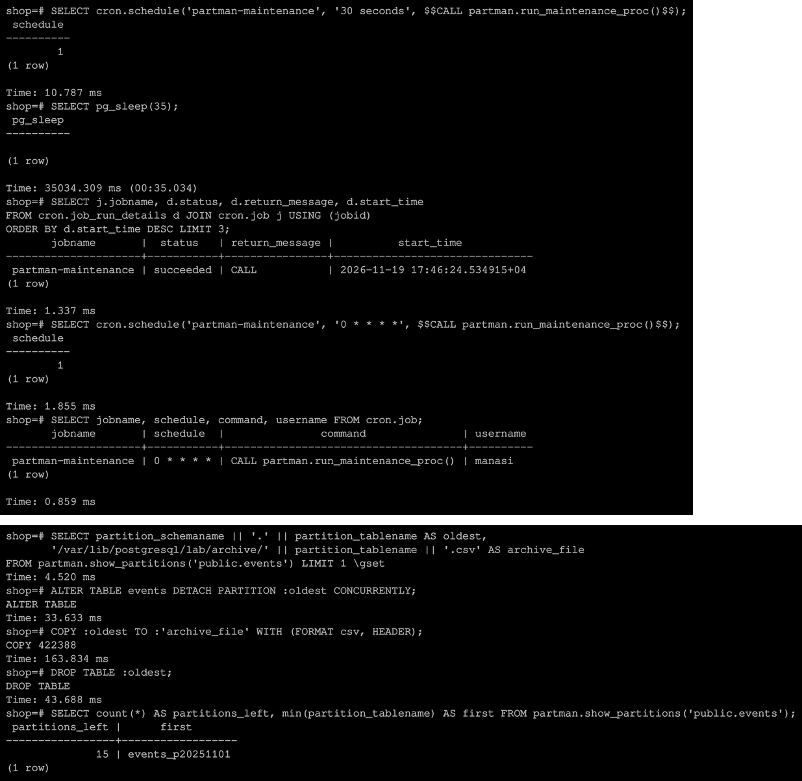

## Results
 
| Measure | Result |
| --- | --- |
| Bulk load: `COPY` of 5M rows into the partitioned table | 14.7 s |
| CDC: changes captured / reader lag after catch-up | 1,600 / 0 bytes |
| Replay of the same change file with `MERGE` | 0 rows changed; 200,900 rows on both sides, same checksum |
| Slot guard: `safe_wal_size` after a 2M-row write to another table | 132 MB -> -174 MB, then `lost` |
| 1-hour query with partition pruning | 1 of 16 partitions read |
| BRIN vs B-tree index size | 384 kB vs 107 MB |
| Detach and archive of the oldest month | 33.6 ms, 422,388 rows |
 
All numbers are from my laptop (20 CPUs, 16 GB RAM).

## Learnings
 
The questions I had while building this, and what I found.
 
**CDC and replication slots**
 
- **Does Postgres do CDC on its own?** No. It writes every change to the WAL, and logical decoding can turn the WAL into row changes. But a consumer must read them through a slot and confirm what it has stored.
- **How does a slot track what a consumer has read?** `confirmed_flush_lsn` is the position the reader confirmed. `restart_lsn` is the oldest WAL the slot still needs, and it decides how much WAL the server keeps. A peek reads changes without moving either one. A streaming reader confirms every few seconds.
- **What happens when the consumer stops?** WAL piles up. There is one WAL for the whole server, and `add-tables=public.orders` only filters what the reader sees. A 300 MB write to an unrelated table took my `orders` slot from `reserved` to `unreserved` (`safe_wal_size` -174 MB). The next `CHECKPOINT` removed that WAL, and the slot was `lost`.
- **How is `safe_wal_size` calculated?** It is the fail point minus the current WAL write position. The fail point is the start of the WAL file that holds `restart_lsn`, plus `max_slot_wal_keep_size` / 16 MB + 1 files. With my 128 MB limit, that is 144 MB.
- **Is there a guard against slots that nobody uses?** Yes, new in PG 18: `idle_replication_slot_timeout`. My unused slot was invalidated at the next checkpoint with reason `idle_timeout`. A lost slot cannot be repaired: you need a new slot and a new snapshot.
- **Why did my first slot creation fail?** PostgreSQL 18.6 added an allow-list for output plugins, `output_plugin_libraries`. wal2json had to be added. A reload was enough.
- **Why does `pgoutput` need a publication, but wal2json does not?** `pgoutput` sends only the tables in a publication. wal2json picks tables with its own `add-tables` option. CDC tools such as Debezium and Fivetran use `pgoutput`.
**Applying the changes**
 
- **How do I avoid a gap between the snapshot and the stream?** Create the slot first, then copy the table. A change can then arrive twice, but never zero times.
- **How do I make a replay safe?** Keep only the last change per key (`DISTINCT ON`), apply it with one `MERGE`, and update a row only when a value differs (`IS DISTINCT FROM`). My second run changed 0 rows, and the md5 checksums of source and target matched.
- **Why not `CREATE TABLE ... AS SELECT` for the target?** It copies only column names, types and data: no primary key, no `NOT NULL`, no defaults. `LIKE ... INCLUDING ALL` copies those too.
- **Why does a delete event carry only the key?** A table's default replica identity is its primary key, so the WAL keeps only the key of a deleted row.
**Partitioning**
 
- **Does `PARTITION BY` create partitions?** No. It creates only the parent, which stores no rows. Until a matching partition exists, an insert fails with `no partition of relation ... found for row`. This is true for RANGE, LIST and HASH. pg_partman creates the partitions for a time range, and keeps creating them ahead of time.
- **Why did I get 16 partitions?** pg_partman works from dates, not from the data: from `p_start_partition` up to 2 months (`p_premake`) after the day I ran it. The data covers 12 months, but in my +04 time zone it touches 13 partitions.
- **Why do my partition bounds fall at 20:00 UTC?** The bounds are midnight in the session's time zone when the partitions were made. My session is +04.
- **Why must the primary key include `event_time`?** Each partition checks uniqueness only inside itself. So the database guarantees that `(event_id, event_time)` is unique, but not `event_id` alone.
- **Why no default partition?** `DETACH ... CONCURRENTLY` is not allowed while one exists. It also hides a missing partition, and each new partition must first scan it.
**Reading query plans**
 
- **Why was my first `EXPLAIN (ANALYZE)` slow?** It was a cold run. The pages came from the OS (`shared read`), not PostgreSQL's cache (`shared hit`), and planning took 8.3 ms to load catalog details. I compare the second run.
- **Which index did the plan use?** An index on a partitioned table is a parent with one child index per partition. The plan names the child, for example `events_p20260401_event_time_idx`. `pg_partition_tree()` shows the parent and its children.
- **Did the planner choose between a seq scan and an index?** It chose for each partition. In my +04 session, a UTC month covered 2 partitions. The planner used a seq scan on March, where almost every row matched, and an index scan on the 4 hours of April. A `Parallel Append` ran both.
- **BRIN or B-tree?** A B-tree is the fastest for a narrow lookup, but it is large and every insert must update it. BRIN is tiny and nearly free on insert. It works well here because `event_time` follows the order of the rows on disk.
- **Why did `SET enable_partition_pruning = off` work without a reload?** `SET` changes the value for my session only. The config file sets only the starting value of each new session, and `RESET` gives it back.
**Small things that cost me time**
 
- `\i` is a psql command, not a shell command. A `shop-#` prompt means psql holds unfinished text: `\r` clears it.
- wal2json option names use hyphens: `format-version`, not `format_version`.
- Server-side `COPY` runs as the Linux user `postgres`, so it needs a folder that this user can write to.
- A `DELETE ... WHERE id IN (SELECT ... LIMIT 100)` without the `LIMIT` deletes every match. My first draft of the CDC script had this bug.

## Repository
 
```text
conf/lab.conf    server settings for the lab cluster
sql/             one file per phase: load, CDC, apply, slot risks, big tables
NOTES.md         my raw numbers, what I expected, and the mistakes I made
```
## References

PostgreSQL 18 documentation
- [Logical decoding concepts: slots, output plugins](https://www.postgresql.org/docs/18/logicaldecoding-explanation.html)
- [pg_replication_slots: wal_status, safe_wal_size, invalidation_reason](https://www.postgresql.org/docs/18/view-pg-replication-slots.html)
- [Replication settings: max_slot_wal_keep_size, idle_replication_slot_timeout](https://www.postgresql.org/docs/18/runtime-config-replication.html)
- [Release notes 18.6: output_plugin_libraries](https://www.postgresql.org/docs/release/18.6/)
- [pg_recvlogical](https://www.postgresql.org/docs/18/app-pgrecvlogical.html)
- [MERGE](https://www.postgresql.org/docs/18/sql-merge.html)
- [Table partitioning and partition pruning](https://www.postgresql.org/docs/18/ddl-partitioning.html)
- [BRIN indexes](https://www.postgresql.org/docs/18/brin.html)
- [ALTER TABLE ... DETACH PARTITION CONCURRENTLY](https://www.postgresql.org/docs/18/sql-altertable.html)

Tools
- [wal2json](https://github.com/eulerto/wal2json) · [pg_partman](https://github.com/pgpartman/pg_partman) · [pg_cron](https://github.com/citusdata/pg_cron)

CDC tools and cloud services
- [Debezium PostgreSQL connector](https://debezium.io/documentation/reference/stable/connectors/postgresql.html)
- [Fivetran: logical replication needs the pgoutput plugin](https://fivetran.com/docs/connectors/databases/postgresql/troubleshooting/invalid-replication-slot-plugin)
- [Fivetran PostgreSQL release notes (PG 18 idle_replication_slot_timeout)](https://fivetran.com/docs/connectors/databases/postgresql/changelog)
- [Airbyte Postgres source (CDC with pgoutput)](https://docs.airbyte.com/integrations/sources/postgres)
- [Google Cloud Datastream: PostgreSQL sources](https://cloud.google.com/datastream/docs/sources-postgresql)
- [AWS DMS: PostgreSQL as a source](https://docs.aws.amazon.com/dms/latest/userguide/CHAP_Source.PostgreSQL.html)
- [Amazon RDS: managing partitions with pg_partman and pg_cron](https://docs.aws.amazon.com/AmazonRDS/latest/UserGuide/PostgreSQL_Partitions.html)
- [Delta Lake: MERGE INTO](https://docs.delta.io/delta-update/)
- [Apache Iceberg: MERGE INTO with Spark](https://iceberg.apache.org/docs/latest/spark-writes/)
 
